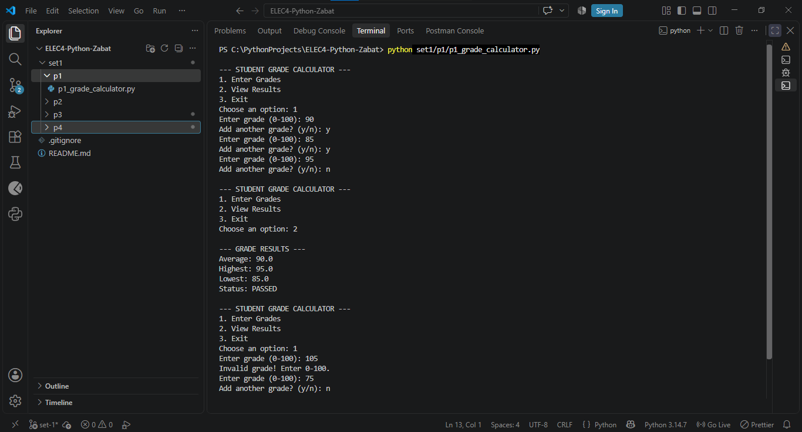
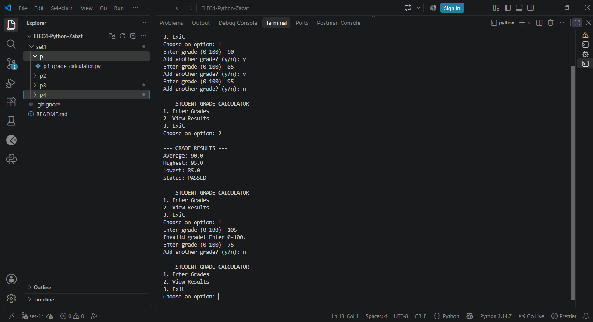
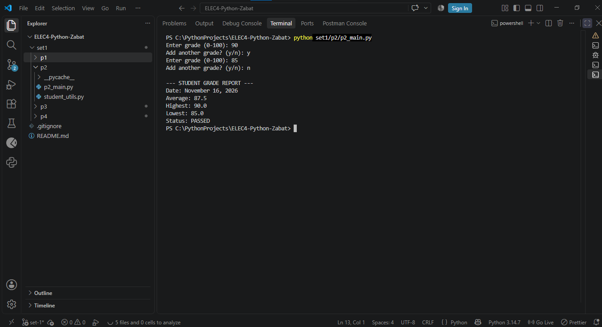
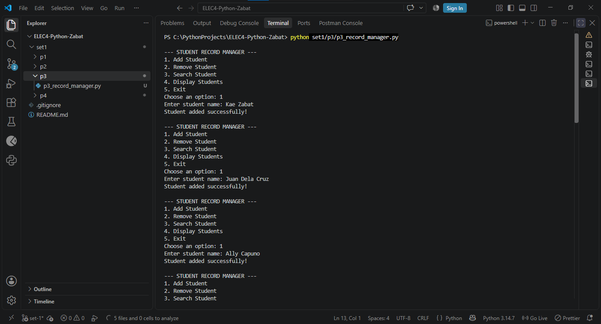
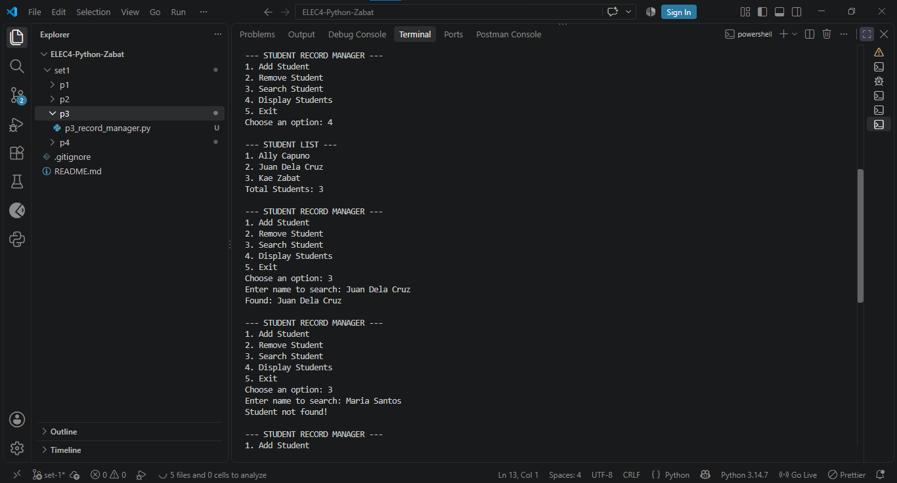
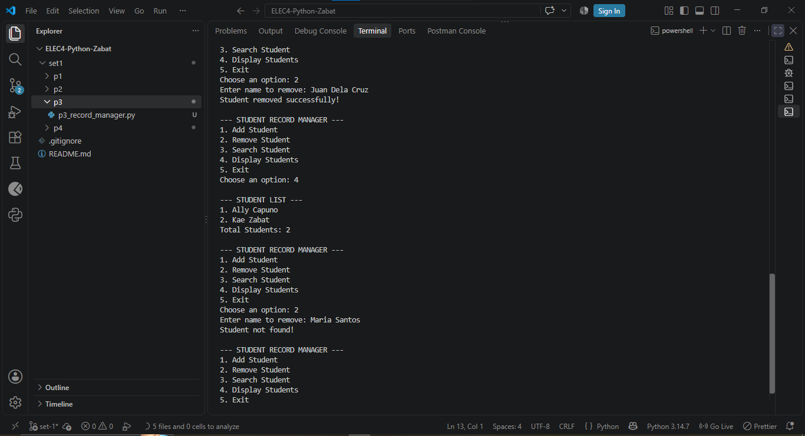
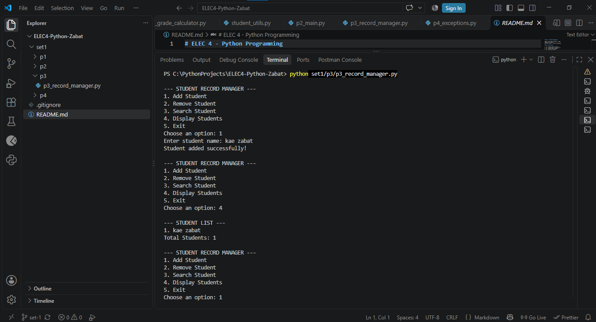
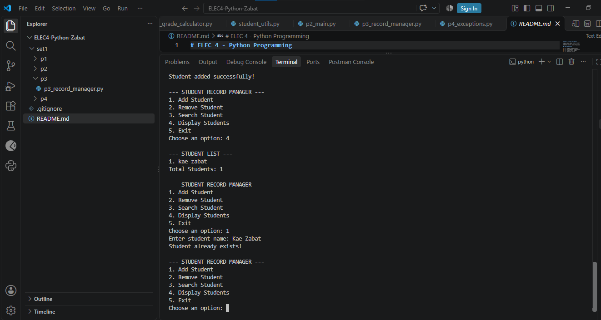
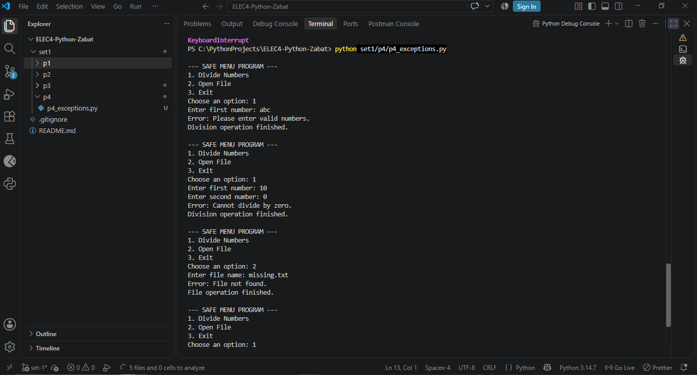
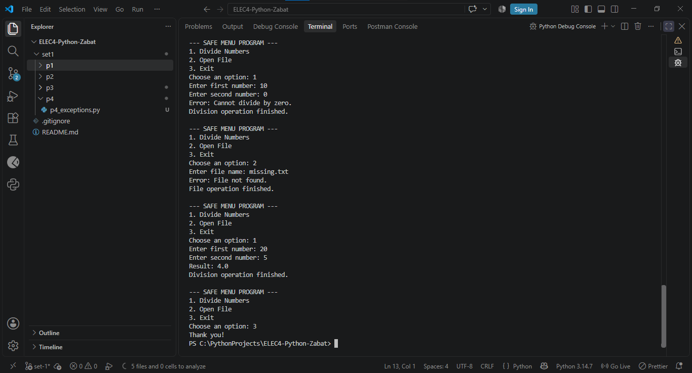

# ELEC 4 - Python Programming

*Name:* KAELA ASHLEY NICOLE R. ZABAT  
*Section:* IV-BSIT-C  
*Course:* ELEC 4 - Python Programming

## Set 1 Activities

### P1 - Student Grade Calculator
A Python program that calculates student grades and displays the results.

*Python File:* p1_grade_calculator.py

*Run:*
python set1/p1/p1_grade_calculator.py

[View P1 Files](set1/p1)

### P2 - Custom Module: student_utils
A Python program demonstrating the use of a custom module.

*Python Files:* p2_main.py, student_utils.py

*Run:*
python set1/p2/p2_main.py

[View P2 Files](set1/p2)

### P3 - Student Record Manager
A Python program for managing student records.

*Python File:* p3_record_manager.py

*Run:*
python set1/p3/p3_record_manager.py

[View P3 Files](set1/p3)

### P4 - Safe Menu Program
A Python program demonstrating exception handling.

*Python File:* p4_exceptions.py

*Run:*
python set1/p4/p4_exceptions.py

[View P4 Files](set1/p4)

## Output Screenshots

### P1 - Student Grade Calculator

### P2 - Custom Module

### P3 - Student Record Manager

### P4 - Safe Menu Program

## GitHub Repository

Repository:
https://github.com/zabatkaela/ELEC4-Python-Zabat

Pull Request:
https://github.com/zabatkaela/ELEC4-Python-Zabat/pull/1

*Pull Request Status:* Successfully merged into main.